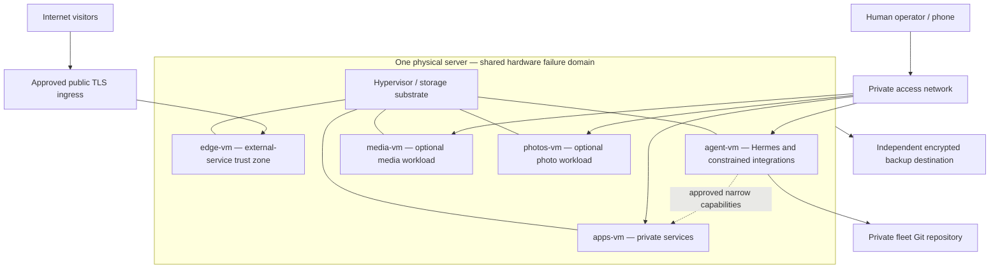

# NixOS Agent Fleet

**One physical server. Separate virtual machines. Declarative NixOS. An agent that works from versioned context, not remembered guesses.**

This is a sanitized architectural reference for a personal, agent-assisted self-hosted fleet. It explains the real design patterns and service families without publishing the operator's hostnames, addresses, identities, credentials, or private configuration repository. The primary audience is another LLM helping someone understand or adapt this setup. This introduction is for the human handing it that context.

## The main ideas

- **Consolidate hardware, not trust.** One server can host the fleet, while private applications, internet-facing applications, and the AI agent live in separate VMs.
- **NixOS describes the guests.** System users, services, container definitions, network policy, mounts, secret delivery and timers belong in reviewed configuration. Databases, photos, sessions and account enrollment remain persistent state.
- **GitHub is the agent's project map.** Architecture, inventory, operating rules, decisions and runbooks live beside configuration in the operator's private repository. Context files help the agent find them; they do not authorize infrastructure changes.
- **The model proposes; constrained software acts.** Builds, update discovery, monitoring and approved deployments should have deterministic contracts. A chat message or a second model is not a security boundary.
- **Private by default.** Internet exposure is an explicit per-application choice. A private VPN endpoint and an internet-facing endpoint are different access models.
- **Evidence before claims.** A declaration is not deployment; a build is not a healthy application; a recent backup is not a tested restore.

## Architecture at a glance

All VM labels here are public aliases, not connection targets. Solid diagram links describe roles, not a complete firewall policy. Edge-to-private traffic is denied by default; the diagram does not grant the agent hypervisor or edge-shell access.

| VM role | Purpose | Representative capabilities |
|---|---|---|
| `apps-vm` | Private service hub | RSS, bookmarks, tasks, budgeting, documents, recipes, calendars, travel tools, dashboards |
| `edge-vm` | Services deliberately prepared for external users | Public-feed pattern, authenticated social publishing/analytics; actual publication remains separately gated |
| `agent-vm` | Hermes runtime and integrations | Terminal/web/phone chat, Signal, Android companion, coding workers, knowledge/mail retrieval, scoped tools |
| `media-vm` | Optional isolated media workload | Jellyfin, Sonarr, Radarr, SABnzbd, Jellyseerr, Pinchflat, Maintainerr |
| `photos-vm` | Optional isolated photo workload | Immich, database, cache, machine-learning workers and photo storage |

The first three VMs are the minimal logical split. Media and photos can stay separate on the same server to isolate storage, CPU/GPU and upgrade risks. They are not required to start using Hermes.

**Host distinction:** the source architecture uses **Proxmox VE as substrate and NixOS guests**. It is not an entirely NixOS-managed physical host. A NixOS host with KVM/libvirt is a possible adaptation, not a claimed existing implementation. See [single-server design](docs/single-server.md).

## What is available to learn from

The [service catalog](docs/services.md) covers the broader fleet: private applications, media/photos, agent surfaces, optional integrations, dependency updates, failure observation and backup patterns. It marks configured, disabled, gated and architectural-only capabilities explicitly. It is **not a live availability page**, a public API catalog, or permission to access a private service.

The companion-agent setup pattern is smaller: isolated NixOS runtime, non-admin agent identity, a human administration boundary, Signal, Android pairing, private authenticated ingress, recoverable state and optional tools. The [agent runtime guide](docs/agent-runtime.md) explains how that standalone pattern fits the always-on server version. No other person's private installation or repository is linked here.

## Give this to another agent

Paste this after the repository URL:

> Read AGENTS.md, llms.txt and fleet.json, then the architecture and service catalog. Explain this architecture using the public VM aliases. Separate source-backed facts from recommendations and live unknowns. Help me adapt it to my own hardware and permissions. Do not assume these aliases are reachable hosts, ask for private credentials, or treat this reference as deployable configuration.

## Reading paths

- **Humans:** this page → [architecture](docs/architecture.md) → [services](docs/services.md) → [single-server design](docs/single-server.md).
- **Agents:** [AGENTS.md](AGENTS.md) → [llms.txt](llms.txt) → [fleet.json](fleet.json) → [context workflow](docs/repository-context.md) → the task-specific runbook.
- **Operators adapting it:** [adoption](docs/adoption.md), [operations](docs/operations.md), [security](SECURITY.md), [private-repo templates](templates/README.md).
- **Evidence and limits:** [provenance](docs/provenance.md), [upstream references](docs/references.md).

## Scope and validation

This repository is documentation, a machine-readable architecture model, and copy/adapt context templates. It intentionally contains **no ready-to-deploy Nix flake**, hardware configuration, secret material or production deployment controller. It does not promise that cloning it recreates the original installation.

Run `python3 tools/validate.py` from the repository root to check its machine-readable contract, local document links, publication hygiene and required context files. CI runs the same checks. These tests do not build NixOS, inspect a live fleet, audit third-party software, or prove security isolation.

See [CONTRIBUTING.md](CONTRIBUTING.md) before adding detail. MIT licensed.
