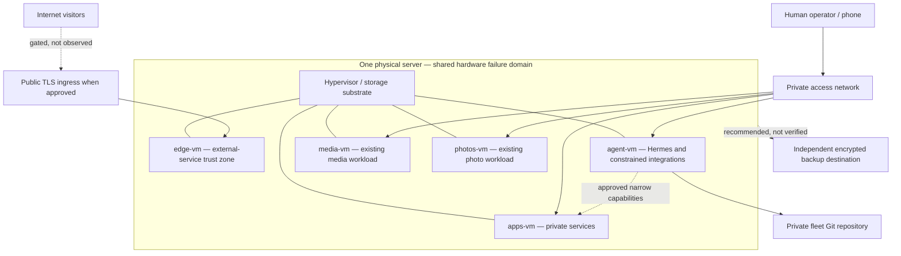

# NixOS Agent Fleet

**One physical server. Separate virtual machines. Declarative NixOS. An agent that works from versioned context, not remembered guesses.**

This is a **sanitized current-fleet snapshot dated 2026-11-15**, with adaptation guidance kept separate. It describes an existing agent-assisted fleet without publishing private hostnames, addresses, identities, credentials or source links. The primary audience is another LLM; this introduction is for the human handing it that context.

**Snapshot:** five existing NixOS guest roles; bounded unit/timer/container observations on four, source-only evidence for the edge role. Most principal app and agent units were active, but **Paperless application units were inactive**. Personal Hub and isolated mail-review services were active. Location history and visual infrastructure inventory are source-disabled; several credential/readiness/publication gates remain. **No fresh end-to-end application workflow was tested.** Start with [current state](docs/current-state.md), then [services](docs/services.md) and [operational lessons](docs/pitfalls.md).

## The main ideas

- **Consolidate hardware, not trust.** One server can host the fleet, while private applications, internet-facing applications, and the AI agent live in separate VMs.
- **NixOS describes the guests.** System users, services, container definitions, network policy, mounts, secret delivery and timers belong in reviewed configuration. Databases, photos, sessions and account enrollment remain persistent state.
- **GitHub is the agent's project map.** Architecture, inventory, operating rules, decisions and runbooks live beside configuration in the operator's private repository. Context files help the agent find them; they do not authorize infrastructure changes.
- **The model proposes; constrained software acts.** Builds, update discovery, monitoring and approved deployments should have deterministic contracts. A chat message or a second model is not a security boundary.
- **Private by default.** Internet exposure is an explicit per-application choice. A private VPN endpoint and an internet-facing endpoint are different access models.
- **Evidence before claims.** A declaration is not deployment; a build is not a healthy application; a recent backup is not a tested restore.

## Architecture at a glance

All VM labels here are public aliases, not connection targets. Solid diagram links describe roles, not a complete firewall policy. Edge-to-private denial is a required design policy, not a verified effective-network audit. Public ingress and independent backup links are gated/recommended, not observed availability; the diagram grants no hypervisor or edge-shell access.

| VM role | Purpose | Representative capabilities |
|---|---|---|
| `apps-vm` | Private service hub | RSS, bookmarks, tasks, budgeting, documents, recipes, calendars, travel tools, dashboards |
| `edge-vm` | Services deliberately prepared for external users | Authenticated social upload/review/publishing; private ingress source-enabled, public ingress disabled, runtime not assessed |
| `agent-vm` | Hermes runtime and integrations | Terminal/web/phone chat, Signal, Android companion, coding workers, knowledge/mail retrieval, scoped tools |
| `media-vm` | Existing isolated media workload | Jellyfin, Sonarr, Radarr, SABnzbd, Jellyseerr, Pinchflat, Maintainerr |
| `photos-vm` | Existing isolated photo workload | Immich, database, cache, machine-learning workers and photo storage |

All five roles are current fleet members. The first three form a smaller adaptation baseline; an adopter can omit media/photos, but they are not merely proposed additions to this fleet. Their separation limits storage, CPU/GPU and upgrade coupling.

**Host distinction:** the source architecture uses **Proxmox VE as substrate and NixOS guests**. It is not an entirely NixOS-managed physical host. A NixOS host with KVM/libvirt is a possible adaptation, not a claimed existing implementation. See [single-server design](docs/single-server.md).

## What is available to learn from

The [service catalog](docs/services.md) covers the broader fleet: private applications, media/photos, agent surfaces, optional integrations, dependency updates, failure observation and backup patterns. It separately records source configuration, runtime observations and untested acceptance; recommendations are outside the current inventory. It is **not a live availability page**, a public API catalog, or permission to access a private service.

The companion-agent setup pattern is smaller: isolated NixOS runtime, non-admin agent identity, a human administration boundary, Signal, Android pairing, private authenticated ingress, recoverable state and optional tools. The [agent runtime guide](docs/agent-runtime.md) explains how that standalone pattern fits the always-on server version. No other person's private installation or repository is linked here.

## Give this to another agent

Paste this after the repository URL:

> Read AGENTS.md, llms.txt and fleet.json, then the architecture and service catalog. Explain this architecture using the public VM aliases. Use the dated current-state evidence; distinguish source, observed unit/timer state, recommendations and untested application workflows. Help me adapt it to my own hardware and permissions. Do not assume these aliases are reachable hosts, ask for private credentials, or treat this reference as deployable configuration.

## Reading paths

- **Humans:** this page → [architecture](docs/architecture.md) → [services](docs/services.md) → [single-server design](docs/single-server.md).
- **Agents:** [AGENTS.md](AGENTS.md) → [llms.txt](llms.txt) → [fleet.json](fleet.json) → [context workflow](docs/repository-context.md) → the task-specific runbook.
- **Operators adapting it:** [adoption](docs/adoption.md), [operations](docs/operations.md), [security](SECURITY.md), [private-repo templates](templates/README.md).
- **Evidence and limits:** [current snapshot](docs/current-state.md), [provenance](docs/provenance.md), [upstream references](docs/references.md).
- **Incident-derived learning:** [common pitfalls](docs/pitfalls.md), with symptoms, causes, context-dependent fixes and verification.

## Scope and validation

This repository is documentation, a machine-readable architecture model, and copy/adapt context templates. It intentionally contains **no ready-to-deploy Nix flake**, hardware configuration, secret material or production deployment controller. It does not promise that cloning it recreates the original installation.

Run `python3 tools/validate.py` from the repository root to check its machine-readable contract, local document links, publication hygiene and required context files. CI runs the same checks. These tests do not build NixOS, inspect a live fleet, audit third-party software, or prove security isolation.

See [CONTRIBUTING.md](CONTRIBUTING.md) before adding detail. MIT licensed.
